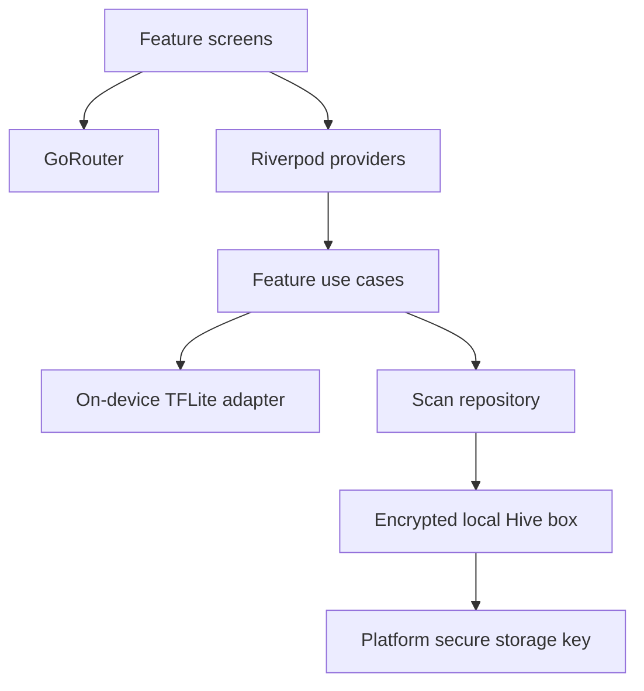

# SkinAI Assist

Flutter starter app for offline-first, educational skin screening. **This application is not a medical diagnostic tool.** Its current scan flow is a UI prototype; it does not classify images until a validated compatible model is supplied and the model adapter is implemented.

## Features in this scaffold

- Material 3 light and dark themes, responsive navigation, and supplied branding
- First-run disclaimer acceptance and three-step onboarding
- Body area and symptom questionnaire, camera capture/review flow
- Educational hub, local history/profile screens, safety guidance
- Riverpod dependency, GoRouter navigation, Hive CE storage encrypted with a key kept in platform secure storage
- TensorFlow Lite dependency and `assets/models/` integration location

## Run in VS Code

Install Flutter and the Flutter/Dart VS Code extensions. Open this folder, run `flutter pub get`, then launch `lib/main.dart` on an Android emulator or device. The local environment used to scaffold this project did not have Flutter/Dart installed, so dependency resolution and device execution still need to be completed on a Flutter-equipped machine.

Camera permissions are required: add `CAMERA` permission to Android and `NSCameraUsageDescription` to iOS before running on hardware. The image picker plugin opens the platform camera UI.

## Add an inference model

1. Obtain a properly licensed, clinically reviewed model and its labels/preprocessing specification. No model is included in this repository.
2. Add the `.tflite` model and labels under `assets/models/`.
3. Implement a `ScreeningModel` service using `tflite_flutter`; match the exact input dimensions, normalization, and output labels from the model card.
4. Add image quality checks (blur, exposure, resolution), confidence calibration, and a tested triage policy. Avoid presenting raw model confidence as medical certainty.
5. Store only the minimum required scan metadata. Keep image inference on-device; cloud upload must be an explicit user choice.

## Architecture

Features live under `lib/features/`; shared theme and services live under `lib/core/`. Firebase is intentionally not configured; offline operation is the default.

## Privacy and safety

Scan metadata is stored in an encrypted Hive box. The encryption key is generated once and stored through `flutter_secure_storage`. Images are not persisted by this scaffold after a session. Do not add cloud image transfer without clear opt-in, secure transport, and a privacy review. The disclaimer and educational content do not replace clinical review.

## Release checklist

- Install the Flutter SDK; run `flutter pub get`, `flutter analyze`, and `flutter test`.
- Supply and validate model assets, license, preprocessing, labels, and device performance.
- Complete camera permission strings, app icons, package identifiers, and signing configuration.
- Review accessibility, privacy, and medical-device/regulatory requirements for intended deployment markets.
