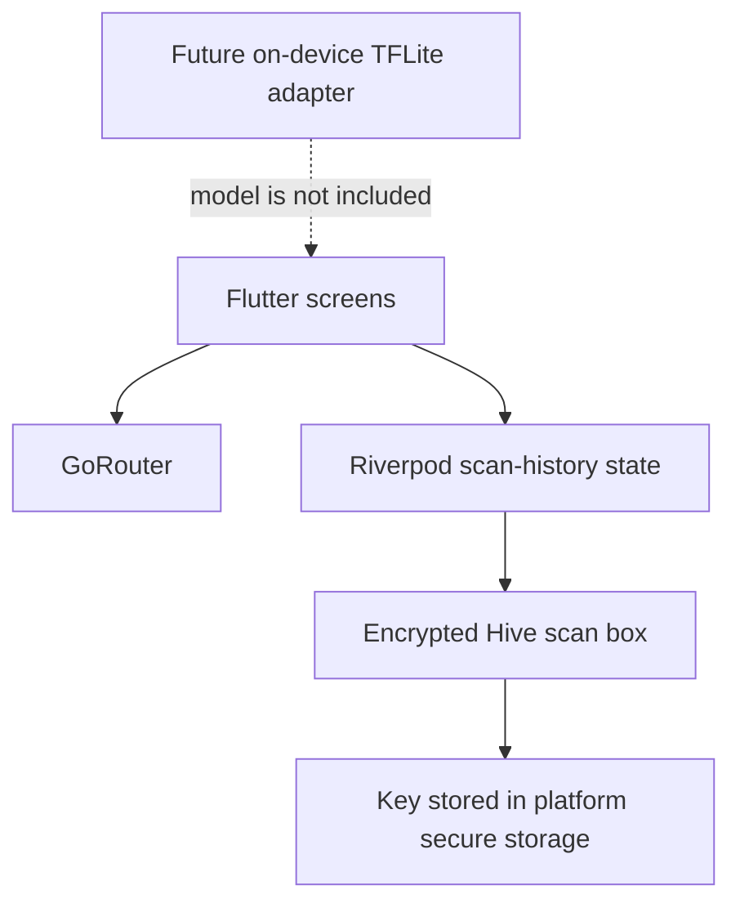

# SkinAI Assist

SkinAI Assist is a Flutter mobile app prototype for educational skin screening. It is **not a medical diagnostic tool**. It does not currently run an AI model or classify skin images. Do not use it to diagnose or make treatment decisions.

## Current implementation

| Area | Status |
| --- | --- |
| Branding, Material 3 theme, light/dark appearance | Implemented |
| Branded startup | Native splash uses the supplied logo; a Flutter loading indicator appears while encrypted storage opens, with retry on failure |
| First-run disclaimer and three-step onboarding | Implemented; acceptance is stored in local preferences |
| Home dashboard and bottom navigation | Implemented; dashboard header stays fixed while its content scrolls |
| Body area and symptom questionnaire | Saves the selected area, answers, and duration as a local visit; no photo is saved to history |
| Camera capture and photo review | Live camera preview, tap-to-focus/exposure, flash toggle, grid overlay, capture/retake, crop, basic resolution/brightness/blur checks, and best-effort temporary photo cleanup; quality checks are heuristic and are not medical validation |
| Analysis and results | Placeholder only; no model output is generated and no risk category is assigned |
| Local storage | Visit metadata and optional profile details are stored in encrypted Hive boxes; onboarding acceptance is stored in a separate local preferences box |
| History, education, profile | History list, detail view, and delete confirmation implemented; profile fields persist in encrypted storage; profile-only and full local-data clear actions are available |
| Emergency advice | Dedicated urgent-care screen linked from Home and Education; includes source references and location-neutral emergency wording |
| Riverpod | Used for encrypted scan-history state and persistence; camera capture remains widget-local state |
| TensorFlow Lite | Dependency and `assets/models/` location are present; no model or inference adapter is included |
| Firebase | Not configured (optional in the project brief) |
| Automated tests | A few starter tests exist; feature and platform coverage is incomplete |

## Requirements

- Flutter SDK with Dart 3.3 or later (the Dart SDK is bundled with Flutter).
- Git and Visual Studio Code with the **Flutter** and **Dart** extensions.
- For Android: Android Studio or Android SDK command-line tools, Android SDK Platform 36, Android Build Tools, Platform Tools, and a Java 17-compatible Android build environment. Android Studio can install and manage these components.
- For iOS: a Mac running a supported version of Xcode. iOS builds and the iOS Simulator cannot be run from Windows.
- A physical device or emulator/simulator for running the app.

Check the local setup:

```sh
flutter --version
dart --version
flutter doctor -v
```

## Open the project in VS Code

1. Open this repository's project folder in VS Code (or open `SkinAI Assist.code-workspace` if it is present in your checkout).
2. Open **Terminal → New Terminal** in the project folder.
3. Fetch dependencies:

   ```sh
   flutter pub get
   ```

4. Select a connected device using **Flutter: Select Device** in the Command Palette, or use `flutter devices` in the terminal.
5. Press **F5** to debug `lib/main.dart`, or run `flutter run` in the terminal.

The first Android build downloads Gradle and Android dependencies and can take several minutes.

## Android setup and run

### Install or verify the Android SDK

In Android Studio, open **Tools → SDK Manager** and install:

- Android SDK Platform 36
- Android SDK Build-Tools (the version recommended by Android Studio)
- Android SDK Platform-Tools
- Android Emulator (if you will use a virtual device)

If Flutter cannot locate a non-default SDK directory, point it to the installed SDK (replace the example path with yours):

```powershell
flutter config --android-sdk 'C:\Android\Sdk'
flutter doctor --android-licenses
flutter doctor -v
```

Accept the licenses when prompted. Do not commit machine-specific SDK paths from `android/local.properties`.

If the system drive is short on space, point Gradle's cache to a drive with more room in the VS Code terminal before building. This project environment uses:

```powershell
$env:GRADLE_USER_HOME = 'D:\Android\GradleCache'
```

This setting applies to that terminal session. Set it as a Windows user environment variable if you want it to apply to newly opened terminals too.

### Start an emulator

Create a virtual device in **Android Studio → Tools → Device Manager** if you do not already have one. Then start it either from Device Manager or the terminal:

```powershell
flutter emulators
flutter emulators --launch <emulator-id>
flutter devices
flutter run -d <device-id>
```

For the configured Windows development environment used for this project, the AVD is named `SkinAI_API_36` and the SDK is at `C:\Android\Sdk`. It can be started directly with:

```powershell
& 'C:\Android\Sdk\emulator\emulator.exe' -avd SkinAI_API_36
```

After Android finishes booting, run `flutter run` from the repository in a VS Code terminal. To run on a Google Pixel, enable **Developer options → USB debugging**, connect and authorize the computer, check `flutter devices`, then run `flutter run -d <pixel-device-id>`.

Useful Android commands:

```sh
flutter run -d <device-id>
flutter build apk --debug
flutter build appbundle --release
```

Release builds still require a production application ID review, release signing keys, and store-specific configuration. The current Android release signing uses the debug key and is not suitable for publishing.

## iOS setup and run

iOS development requires macOS and Xcode; Windows can edit the iOS source but cannot build, launch an iOS Simulator, or sign an iOS app.

1. Install Xcode and its command-line tools on a Mac, then accept its license and select the installed Xcode:

   ```sh
   sudo xcode-select --switch /Applications/Xcode.app/Contents/Developer
   sudo xcodebuild -license accept
   flutter doctor -v
   ```

2. In Xcode, install an iOS Simulator runtime or connect a trusted iPhone. For a physical iPhone, configure the Apple development team and signing in the Runner target.
3. From the repository folder, run:

   ```sh
   flutter pub get
   flutter devices
   flutter run -d <ios-device-id>
   ```

   Alternatively, open `ios/Runner.xcworkspace` in Xcode, select the Runner scheme and a simulator/device, then run it.

The iOS deployment target in the project is iOS 15.0. Camera access is described in `ios/Runner/Info.plist`; Android camera permission is declared in `android/app/src/main/AndroidManifest.xml`. The app uses a live camera preview for capture, then allows cropping and review. Camera support depends on simulator and device hardware; use a physical device when the simulator does not provide a usable camera.

Useful iOS command (run on macOS only):

```sh
flutter build ios --debug
```

App Store/TestFlight release builds also need a unique bundle identifier, Apple signing and provisioning, and release review.

## Run checks

These are the standard project checks; they are not a claim that every requirement is already covered by tests:

```sh
flutter analyze
flutter test
```

## Project layout

```text
lib/
  app.dart                         GoRouter setup, app shell, disclaimer, onboarding
  main.dart                        Flutter startup and encrypted Hive setup
  core/
    providers/scan_providers.dart Riverpod scan-history state and actions
    services/scan_store.dart       Local visit record model and encrypted Hive store helper
    theme/app_theme.dart           Material 3 light/dark themes
    widgets/common.dart            Shared presentation widgets
  features/
    dashboard/presentation/        Home dashboard
    scan/presentation/              Questionnaire, camera and review flow
    history/presentation/           Local history screen
    education/presentation/         Educational topics and urgent-care guidance
    profile/presentation/           Optional profile fields
assets/
  images/skinai_logo.png
  models/                           Reserved for a properly licensed TFLite model
android/                            Android Gradle project, manifest, icons and splash
ios/                                Xcode project, permissions, icons and launch screen
```



## Privacy and safety

- The app does not upload images. Captured images stay in local temporary storage during a scan and are not saved as scan records; temporary captured/cropped files are removed when the scan ends or is abandoned (best effort).
- Startup creates encrypted Hive boxes for scan records and profile details and stores their encryption key using platform secure storage. The onboarding acceptance flag is kept in a separate, non-encrypted local preferences box.
- Do not add image upload without explicit user choice, secure transport, and a privacy review. Never put API keys or signing credentials in source control.
- The disclaimer and educational information do not replace a clinician. Do not display unvalidated model output as medical certainty.

## Remaining work from the project brief

### Required before the app can perform screening

- Obtain a properly licensed and clinically reviewed EfficientNet-Lite0 or MobileNetV3 model, its labels, preprocessing details, and model card. None is included in this repository.
- Implement and integrate the on-device TFLite inference adapter, image preprocessing, confidence calibration, and a validated triage policy. Until then, the app must not claim to analyze/classify an image.
- Tune and validate image quality thresholds across supported phone cameras and skin tones; current checks are preliminary heuristics only.
- Implement the analysis progress flow and real result presentation only after a model is available. Show top predictions, calibrated confidence, risk category, and appropriately reviewed recommendations; include an explicit emergency path.

### App features still to complete

- Persist model results with a clear status after a validated inference model becomes available; current history stores questionnaire metadata only.
- Verify camera preview, flash, focus, grid, and cropping behavior across supported Android/iOS devices; camera capabilities vary by hardware.
- Extend Riverpod to profile, onboarding preferences, and future inference state as those features are completed.

### Verification and release work still to complete

- Add unit, widget, and device-level tests for consent, navigation, camera cancellation, scan persistence, safety messaging, and supported screen sizes. Existing tests are only starter coverage.
- Review accessibility (screen-reader labels, contrast, text scaling, tap targets) and phone/tablet layouts.
- Measure cold launch, image processing, and inference time on representative devices. The brief's performance targets are not yet measured.
- Confirm app identifiers, Android/iOS permissions, privacy disclosures, signing/provisioning, and release builds for each store.
- Review intended market-specific medical-device, privacy, and regulatory requirements before any real-world screening deployment.

Firebase is listed as optional in the brief and is not configured; offline operation is the current direction. Do not add a backend unless the product requirements change.
