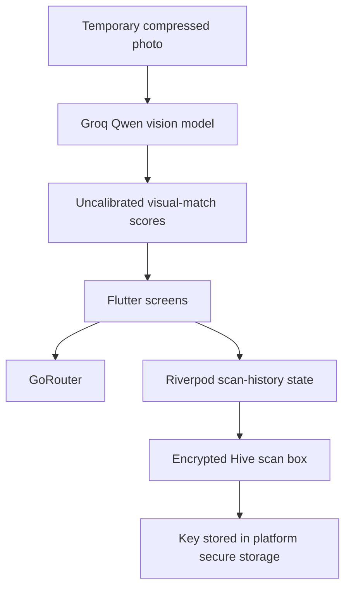

# SkinAI Assist

SkinAI Assist is a Flutter mobile app prototype for educational skin screening. It is **not a medical diagnostic tool**. Its experimental AI output is for demonstrating cloud vision inference only; do not use it to diagnose or make treatment decisions.

## Current implementation

| Area | Status |
| --- | --- |
| Branding, Material 3 theme, light/dark appearance | Implemented |
| Branded startup | Native splash uses the supplied logo; a Flutter loading indicator appears while encrypted storage opens, with retry on failure |
| First-run disclaimer and three-step onboarding | Implemented; acceptance is stored in local preferences |
| Home dashboard and bottom navigation | Illustrated hero, fixed brand header, quick links, recent visit card, and locally saved daily care checklist |
| Body area and symptom questionnaire | Includes a custom body-part field when “Other” is selected; saves the selected area, answers, and duration as a local visit; no photo is saved to history |
| Camera capture and photo review | Live camera preview, tap-to-focus/exposure, flash toggle, grid overlay, capture/retake, crop, basic resolution/brightness/blur checks, and best-effort temporary photo cleanup; quality checks are heuristic and are not medical validation |
| Analysis and results | Local image-quality checks followed by a direct Groq Qwen vision request; the photo is sent to Groq and is not stored in Firebase or visit history; returned scores are uncalibrated visual-match estimates |
| Local storage | Visit metadata and optional profile details are stored in encrypted Hive boxes; onboarding acceptance is stored in a separate local preferences box |
| History, education, profile | Searchable learning topics with illustrations, history list and details, profile fields in encrypted storage, and local-data clear actions |
| Account access | Firebase email/password sign-in and account creation, protected app routes, sign-out, and a prototype demo account |
| Cloud account data | Firestore sync for profile details, care-routine preferences, and scan metadata; scan images remain on device |
| Emergency advice | Dedicated urgent-care screen linked from Home and Education; includes source references and location-neutral emergency wording |
| Riverpod | Used for encrypted scan-history state and persistence; camera capture remains widget-local state |
| Groq vision | `qwen/qwen3.8-27b` considers the scan photo and questionnaire answers, then suggests up to five candidates with independent uncalibrated 0–100 visual-match scores; it may name conditions outside the PAD-UFES-20 and MSLD v2.0 reference labels |
| Firebase | Authentication and Firestore are used for account data; scan inference calls Groq directly from the app |
| Automated tests | A few starter tests exist; feature and platform coverage is incomplete |

## Requirements

- Flutter SDK with Dart 3.3 or later (the Dart SDK is bundled with Flutter).
- Git and Visual Studio Code with the **Flutter** and **Dart** extensions.
- For Android: Android Studio or Android SDK command-line tools, Android SDK Platform 36, Android Build Tools, Platform Tools, and a Java 17-compatible Android build environment. Android Studio can install and manage these components.
- For iOS: a Mac running a supported version of Xcode. iOS builds and the iOS Simulator cannot be run from Windows.
- A physical device or emulator/simulator for running the app.
- A Firebase project with Email/Password Authentication and Cloud Firestore enabled.
- A GroqCloud account and API key for the vision model.

## AI model (educational prototype)

The active scan flow runs local image-quality checks, then sends a compressed
photo and the selected body area, symptom answers, and duration directly from
the app to Groq's `qwen/qwen3.8-27b` vision model. The general vision model is
prompted to suggest up to five candidates, including labels from PAD-UFES-20
and MSLD v2.0 and possible conditions outside those datasets. It was not trained
specifically on those datasets or on every skin condition. Its independent
0–100 match scores are not calibrated probabilities, and Groq is not a
validated dermatology classifier. A data-use notice appears on the photo-review
screen before analysis.
The app does not store the image in Firebase or visit history; Groq's inference
data controls are described in its [data policy](https://console.groq.com/docs/your-data).
For this prototype, `GROQ_API_KEY` is passed with `--dart-define`; it becomes
part of the app binary and must only be used in a private demo build. Anyone
with a distributed APK may be able to extract and use the key. Use a backend
proxy for any APK shared outside your own devices.

No dedicated skin/no-skin gate runs in the active scan flow. Image quality
checks do not verify that skin or the selected body area is present. The old
local PAD/MSLD model and UCI pixel gate have been removed from the mobile
runtime; their model and evaluation artifacts remain in the repository for
historical research only. Their small or unbalanced datasets and weak cancer
recall do not support real screening. A low score or healthy-looking result
cannot rule out cancer or replace care from a clinician.

Older multimodal training experiments are archived under
[`ai_training/deferred_multimodal`](ai_training/deferred_multimodal) and are
not used by the app.

Check the local setup:

```sh
flutter --version
dart --version
flutter doctor -v
```

## Open the project in VS Code

1. Open this repository's project folder in VS Code (or open `SkinAI Assist.code-workspace` if it is present in your checkout).
2. Open **Terminal → New Terminal** in the project folder.
3. Fetch dependencies:

   ```sh
   flutter pub get
   ```

4. Select a connected device using **Flutter: Select Device** in the Command Palette, or use `flutter devices` in the terminal.
5. Press **F5** and choose **SkinAI Assist (direct Groq prototype)** to enter
   the Groq token securely in a prompt, or use the command in the Groq setup
   section below.

The first Android build downloads Gradle and Android dependencies and can take several minutes.

## Firebase setup (required for account features)

The app uses Firebase Authentication for sign-in/sign-up. Firestore stores each user's profile, care-routine preferences, and scan metadata under that user's UID. Scan images are **not written to Firebase Storage, Firestore, or visit history**. With explicit confirmation, a compressed copy is sent directly from the app to Groq for analysis. Local Hive storage remains as an offline cache. Firestore security rules are in [`firestore.rules`](firestore.rules).

1. Create a Firebase project in the Firebase Console.
2. Add an Android app with package name `com.skinaiassist.skinai_assist`, and an iOS app with bundle ID `com.skinaiassist.skinaiAssist`.
3. In **Authentication → Sign-in method**, enable **Email/Password**.
4. Create a **Cloud Firestore** database. In **Firestore → Rules**, publish the contents of `firestore.rules`. These rules limit each account to its own document and scan subcollection.
5. Download the Android `google-services.json` and put it at `android/app/google-services.json`. The Google Services Gradle plugin is enabled in this project.
6. For iOS, download `GoogleService-Info.plist`, add it to the `ios/Runner` folder, and include it in the Runner target in Xcode. iOS builds require macOS and Xcode.
7. Run the Android app from the project folder:

   ```powershell
   flutter pub get
   flutter run
   ```

The repository also supports runtime Firebase options through `--dart-define` (`FIREBASE_API_KEY`, `FIREBASE_PROJECT_ID`, `FIREBASE_MESSAGING_SENDER_ID`, and the platform-specific `FIREBASE_*_APP_ID`) for platforms without native config files.

The **Try demo account** button uses `demo@skinai.app` with password `SkinAI123!`. On first use, the app creates this account in the connected Firebase project; later uses sign into it. These credentials are deliberately public for presentations. Do not use this demo account for real user data, and remove the demo shortcut before any public release.

If Firebase has not been configured for the target platform, the app still opens, but sign-in and account creation show that Firebase setup is required.

## Groq image analysis setup (private prototype build)

1. Create a Groq API key at [GroqCloud API Keys](https://console.groq.com/keys).
   The label you give it in Groq (for example, `SKIN AI`) is only its name; use
   the actual secret token shown by Groq.
2. Open this repository in VS Code and open **Terminal → New Terminal**.
3. Start the app with the key supplied at build time:

   ```powershell
   flutter run --dart-define=GROQ_API_KEY=gsk_REPLACE_WITH_YOUR_TOKEN
   ```

   Replace the example value with your actual Groq token. Do not put the token
   in Dart source or commit it to Git. Because `--dart-define` is compiled
   into the app, this direct method is for a private prototype only; do not
   distribute that APK. A backend proxy is needed to protect the key in a
   shared or public build.

4. To build an APK for your own phone, pass the same define:

   ```powershell
   flutter build apk --release --dart-define=GROQ_API_KEY=gsk_REPLACE_WITH_YOUR_TOKEN
   ```

5. Sign in, choose the body area, answer the symptom and duration questions,
   select or capture a photo, accept the disclosure, and run the scan. The
   phone must be online. Groq usage is subject to your account limits and
   terms. Inference requests are not retained by default, but may be
   temporarily logged for reliability or abuse investigation. See
   [Groq data controls](https://console.groq.com/docs/your-data).

The included VS Code launch configuration prompts for the token each time and
does not save it in the repository. The token is still compiled into the
running app, so use this configuration only for a private prototype.

## Android setup and run

### Install or verify the Android SDK

In Android Studio, open **Tools → SDK Manager** and install:

- Android SDK Platform 36
- Android SDK Build-Tools (the version recommended by Android Studio)
- Android SDK Platform-Tools
- Android Emulator (if you will use a virtual device)

If Flutter cannot locate a non-default SDK directory, point it to the installed SDK (replace the example path with yours):

```powershell
flutter config --android-sdk 'C:\Android\Sdk'
flutter doctor --android-licenses
flutter doctor -v
```

Accept the licenses when prompted. Do not commit machine-specific SDK paths from `android/local.properties`.

If the system drive is short on space, point Gradle's cache to a drive with more room in the VS Code terminal before building. This project environment uses:

```powershell
$env:GRADLE_USER_HOME = 'D:\Android\GradleCache'
```

This setting applies to that terminal session. Set it as a Windows user environment variable if you want it to apply to newly opened terminals too.

### Start an emulator

Create a virtual device in **Android Studio → Tools → Device Manager** if you do not already have one. Then start it either from Device Manager or the terminal:

```powershell
flutter emulators
flutter emulators --launch <emulator-id>
flutter devices
flutter run -d <device-id>
```

For the configured Windows development environment used for this project, the AVD is named `SkinAI_API_36` and the SDK is at `C:\Android\Sdk`. It can be started directly with:

```powershell
& 'C:\Android\Sdk\emulator\emulator.exe' -avd SkinAI_API_36
```

After Android finishes booting, run `flutter run` from the repository in a VS Code terminal. To run on a Google Pixel, enable **Developer options → USB debugging**, connect and authorize the computer, check `flutter devices`, then run `flutter run -d <pixel-device-id>`.

Useful Android commands:

```sh
flutter run -d <device-id>
flutter build apk --debug
flutter build appbundle --release
```

Release builds still require a production application ID review, release signing keys, and store-specific configuration. The current Android release signing uses the debug key and is not suitable for publishing.

## iOS setup and run

iOS development requires macOS and Xcode; Windows can edit the iOS source but cannot build, launch an iOS Simulator, or sign an iOS app.

1. Install Xcode and its command-line tools on a Mac, then accept its license and select the installed Xcode:

   ```sh
   sudo xcode-select --switch /Applications/Xcode.app/Contents/Developer
   sudo xcodebuild -license accept
   flutter doctor -v
   ```

2. In Xcode, install an iOS Simulator runtime or connect a trusted iPhone. For a physical iPhone, configure the Apple development team and signing in the Runner target.
3. From the repository folder, run:

   ```sh
   flutter pub get
   flutter devices
   flutter run -d <ios-device-id>
   ```

   Alternatively, open `ios/Runner.xcworkspace` in Xcode, select the Runner scheme and a simulator/device, then run it.

The iOS deployment target in the project is iOS 15.0. Camera access is described in `ios/Runner/Info.plist`; Android camera permission is declared in `android/app/src/main/AndroidManifest.xml`. The app uses a live camera preview for capture, then allows cropping and review. Camera support depends on simulator and device hardware; use a physical device when the simulator does not provide a usable camera.

Useful iOS command (run on macOS only):

```sh
flutter build ios --debug
```

App Store/TestFlight release builds also need a unique bundle identifier, Apple signing and provisioning, and release review.

## Run checks

These are the standard project checks; they are not a claim that every requirement is already covered by tests:

```sh
flutter analyze
flutter test
```

## Project layout

```text
lib/
  app.dart                         GoRouter setup, app shell, disclaimer, onboarding
  main.dart                        Flutter startup and encrypted Hive setup
  core/
    providers/scan_providers.dart Riverpod scan-history state and actions
    services/scan_store.dart       Local visit record model and encrypted Hive store helper
    theme/app_theme.dart           Material 3 light/dark themes
    widgets/common.dart            Shared presentation widgets
  features/
    dashboard/presentation/        Home dashboard
    scan/presentation/              Scan flow plus extracted camera/result widgets
    history/presentation/           Local history screen
    education/presentation/         Educational topics and urgent-care guidance
    profile/presentation/           Optional profile fields
assets/
  images/skinai_logo.png
  models/                           Archived MobileNetV3 TFLite research artifacts (not bundled)
android/                            Android Gradle project, manifest, icons and splash
ios/                                Xcode project, permissions, icons and launch screen
```



## Privacy and safety

- The app asks before cloud analysis. If the user continues, a compressed photo is sent over TLS directly to Groq. The app does not write the photo to Firebase Storage, Firestore, or scan history; temporary local captured/cropped files are removed when the scan ends or is abandoned (best effort).
- Groq says inference requests are not retained by default, but may be temporarily logged for reliability or abuse investigation, for up to 30 days. Review Groq's current [data controls](https://console.groq.com/docs/your-data) before using identifiable or sensitive images.
- Startup creates encrypted Hive boxes for scan records and profile details and stores their encryption key using platform secure storage. The onboarding acceptance flag is kept in a separate, non-encrypted local preferences box.
- The direct prototype build embeds the Groq key, so use it only on your own devices and revoke it after the demo. Never commit the key to source control. Use a backend proxy before sharing the app.
- The disclaimer and educational information do not replace a clinician. Do not display unvalidated model output as medical certainty.

## Remaining work from the project brief

### Required before clinical or real-world screening

- Independently validate the model on representative local populations, camera conditions, and skin tones. Current test support is too small for melanoma and squamous cell carcinoma.
- Calibrate confidence and obtain clinical review of any triage policy before exposing medical risk categories or recommendations. The app currently reports experimental class scores only.
- Tune and validate image quality thresholds across supported phone cameras and skin tones; current checks are preliminary heuristics only.
- Improve rare-class detection and evaluate a larger patient-held-out or external dataset before making model claims.

### App features still to complete

- Model class and score are stored with visit metadata; risk remains explicitly not assessed.
- Verify camera preview, flash, focus, grid, and cropping behavior across supported Android/iOS devices; camera capabilities vary by hardware.
- Extend Riverpod to profile, onboarding preferences, and future inference state as those features are completed.

### Verification and release work still to complete

- Add unit, widget, and device-level tests for consent, navigation, camera cancellation, scan persistence, safety messaging, and supported screen sizes. Existing tests are only starter coverage.
- Review accessibility (screen-reader labels, contrast, text scaling, tap targets) and phone/tablet layouts.
- Measure cold launch, image processing, and inference time on representative devices. The brief's performance targets are not yet measured.
- Confirm app identifiers, Android/iOS permissions, privacy disclosures, signing/provisioning, and release builds for each store.
- Review intended market-specific medical-device, privacy, and regulatory requirements before any real-world screening deployment.

Firebase is integrated in the app code, but a project still needs to be connected using the setup steps above. Account data sync is best-effort while offline and syncs again at the next launch/sign-in. Confirm the data-retention and privacy disclosures before using real user accounts.
